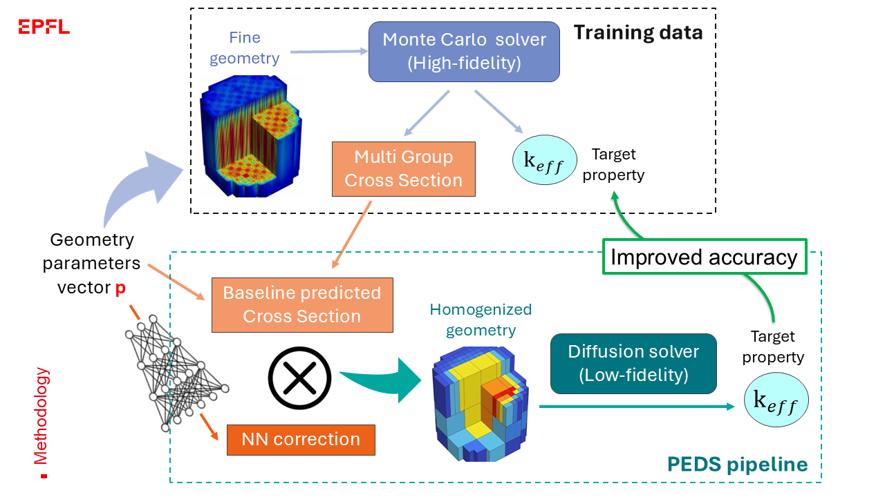

# Physics-Enhanced Deep Surrogate Models for Neutron Transport Solvers (PEDS-NT)

This repository contains the code and data for the Master's thesis **"Physics-Enhanced Deep Surrogate Models for Neutron Transport Solvers"** by Caterina Frau (EPFL – ETH Zürich Joint Master's in Nuclear Engineering, conducted at UC Berkeley). 📄 **[Read the full Master's Thesis (PDF)](thesis_PDF/Caterina_Frau_Master_Thesis.pdf)**

## Overview & Goal

Neutron transport calculations are central to nuclear reactor analysis and design, but high-fidelity continuous-energy Monte Carlo simulations become computationally prohibitive when repeated evaluations are required across large parameter spaces. Conversely, deterministic low-fidelity solvers (such as neutron diffusion) are orders of magnitude faster but introduce physical and spatial approximations that limit their accuracy.

This project adapts the **Physics-Enhanced Deep Surrogate (PEDS)** framework to neutron transport eigenvalue problems. The goal is to bridge the accuracy–cost trade-off: preserving the rapid execution, physical structure, and interpretability of a deterministic diffusion solver while approaching the predictive accuracy of Monte Carlo simulations with minimal training data.

---


## Methodology



As illustrated in the architecture diagram above, the PEDS-NT pipeline couples a neural network generator with an embedded low-fidelity physics solver, trained end-to-end against a high-fidelity reference:

1. **High-Fidelity Reference (**`OpenMC`**):** Continuous-energy Monte Carlo simulations are run over a parameterized reactor geometry vector $\mathbf{p}$ to generate reference values for the effective multiplication factor ($k_{\text{eff}}$) and extract reference multigroup cross sections (MGXS).
2. **Baseline Cross-Section Estimate:** To avoid running Monte Carlo calculations at inference time, a fast polynomial regression model maps the geometry and material parameters $\mathbf{p}$ to an initial coarse estimate of the homogenized MGXS ($\Sigma_{\text{base}}^{\text{MGXS}}(\mathbf{p})$).
3. **Neural Network Generator:** Rather than predicting $k_{\text{eff}}$ directly as a black box, a Multi-Layer Perceptron (MLP) learns a set of multiplicative corrections to refine the baseline cross sections:
  $$
  \Sigma_{\text{final}}^{\text{NN}}(\mathbf{p}) = \Sigma_{\text{base}}^{\text{MGXS}}(\mathbf{p}) \times \text{NN}_{\theta}(\mathbf{p})
  $$
4. **Embedded Low-Fidelity Solver (1D Diffusion):** The corrected MGXS tensor is passed into a custom 1D finite-volume multigroup neutron diffusion solver, which solves the eigenvalue problem on a homogenized spatial grid to output the predicted $k_{\text{eff}}$.
5. **Adjoint-Based Backpropagation (Custom VJP):** Because the external diffusion solver is not natively differentiable, gradients of the loss with respect to the cross sections ($\partial k_{\text{eff}} / \partial \Sigma$) are computed analytically via a custom vector-Jacobian product (VJP) based on the **adjoint neutron flux** ($\phi^\dagger$), enabling fast end-to-end training in JAX without backpropagating through the solver's iterations.

---


## Case Study & Key Results

The framework is evaluated on a 1D cylindrical, two-energy-group reactor core model consisting of three concentric regions (control rod, fuel annulus, and water reflector) defined by a six-parameter design space:

- **Accuracy Improvement:** On the held-out test set, PEDS reduces the mean reactivity discrepancy between the coarse diffusion solver and OpenMC by **~90%** (88.1% across stratified bins).
- **Speed & Data Efficiency:** The low-fidelity surrogate evaluates four orders of magnitude faster than OpenMC (~9 ms per forward solve vs. ~65 s in OpenMC) and reaches optimal performance with a training set of **1,000 samples**.
- **Forward Design Study:** An ensemble of five PEDS models was used to screen 5,000 candidate core geometries for near-criticality ($k_{\text{eff}} \approx 1$) and low radial power peaking factor (PPF) in under 5 minutes. High-fidelity OpenMC verification of the top 30 candidates confirmed 28 viable designs, demonstrating that the upfront training cost is fully recovered after just **four design searches**.

---


## Repository Structure

```
PEDS_NT/
├── config_and_run/                      # Training configuration and Slurm launchers
│   ├── config_peds.py                   # Hyperparameters, dataset path, loss/split settings
│   ├── run_peds.sh                      # Main Slurm training launcher (invokes models/PEDS.py)
│   └── smoke_test_peds.sh               # Quick end-to-end training sanity check
├── data/                                # High-fidelity OpenMC datasets and merged tables
│   ├── highfidelity/
│   │   ├── 17jul_0.8_1.2.npz            # Primary dataset used for PEDS NN training/eval
│   │   └── split_cache/                 # Cached stratified train/val/test split indices
│   └── files/                           # Merged CSVs (dataset_keff_xs.csv) and dataset builders
├── models/                              # PEDS model, training modules, and MLP baselines
│   ├── PEDS.py                          # Main PEDS training loop with custom JAX VJP
│   ├── matrix_JAX_optimized.py          # JAX-accelerated diffusion matrix & adjoint VJP ops
│   ├── PEDS_core/                       # Diagnostics (gradient/FD checks) and timing utilities
│   ├── PEDS_subdivision/                # Modular runtime helpers (context, data, solver, logging)
│   └── run_mlp_*_compare.py             # Pure-MLP and augmented-MLP baseline trainers
├── solvers/                             # Low- and high-fidelity neutron transport solvers
│   ├── LF_diffusion/                    # 1D multigroup diffusion solver, geometry configs, and
│   │   │                                # polynomial XS regression model (regression_model/)
│   │   ├── config_def.py / config_run.py
│   │   ├── diffusion_solver.py          # Solver entry point & XS prediction pipeline
│   │   └── core/                        # Finite-volume MG diffusion & inverse-power solvers
│   └── HF_openMC/                       # OpenMC Monte Carlo solver, TD generation & design API
├── example_applications/                # Thesis experiments, ablations, and design study
│   ├── main_results/                    # Final PEDS & MLP baseline runs and analysis outputs
│   ├── forward_design_study/            # 5k-sample PEDS ensemble screening & OpenMC checks
│   └── additional_studies/              # Train-size, keff-range, gradient, and mesh studies
├── utils/                               # Post-processing, test evaluation, and plotting
│   ├── run_analysis.sh                  # Slurm launcher for full study post-processing
│   ├── run_testset.sh                   # Slurm launcher for held-out test-set evaluation
│   ├── analysis/                        # Test metrics, param-error, pub plots, XS/training stats
│   └── inclusion_criteria_plots/        # Dataset keff distribution & inclusion figures
└── requirements.txt
```

